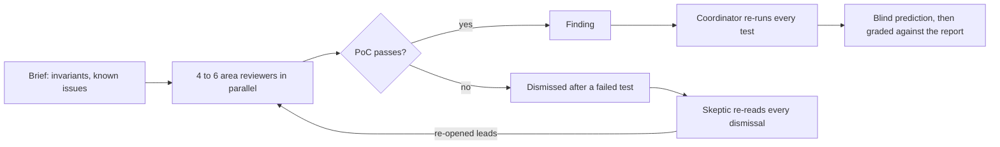

# Blind audit eval

A multi-agent smart-contract audit pipeline, graded blind against published Code4rena reports, with the proofs, the misses, and what each miss changed. Author: Lee R. Beck ([leeb003](https://github.com/leeb003)). Written November 2026.

## Summary

A multi-agent smart-contract audit pipeline, run blind on four finished Code4rena contests in September 2026, found 12 of the 25 High and Medium findings the official reports later confirmed (48%), including 2 of the 5 Highs. Every finding and every dismissal had to carry a passing Foundry test before it counted, and the model never graded its own output.

The pipeline was then run on two live contests. On Cantina (Revert v4lend, 17,366 lines, $50k pool) it produced two Mediums, both judged valid and both duplicates of confirmed issues. On Immunefi (Plether Perps, about 18,500 lines) it found nothing above Low after 63 proofs, matched the written prediction, and nothing was submitted.

The interesting result is not the recall number. It is that the misses were classifiable, and each class became a rule in the process: the second graded run after the rules changed went from 4 of 11 to 3 of 4 and 5 of 7. This write-up gives the method, the per-contest scorecards, the misses, and what the numbers do and do not show.

## The pipeline

One run is 4 to 6 Claude Code reviewers, all on Claude Fable (Fable 5.1 on the Plether run, where the session log survives), working in parallel on separate areas of the codebase, one cross-cutting skeptic, and a coordinator. Each reviewer gets a brief: the README's areas of concern and invariants turned into a checklist, the known-issues list (prior audits, bot reports), and the rule that nothing counts without a test.

A lead is accepted as a finding only when a Foundry proof-of-concept passes against the contest's own build. A lead is dismissed only after a test attempt fails to reproduce it, not by argument. Reviewers hand overlapping leads to each other by area, and the skeptic re-reads every dismissal. The coordinator re-runs every reviewer's test suite from a clean checkout before anything is written up, then writes a severity call per finding and a blind prediction of the official result.

On a live contest the human steps in at the end: I read the consolidated findings, decide what to submit, and submit under my own account. Nothing is submitted by the pipeline.

A lead leaves the loop only one way: as a finding with a passing proof, or as a dismissal the skeptic has re-read.

## How grading works

The test is blind. A finished Code4rena contest is chosen only by its headline count of Highs and Mediums. The official report, the findings repository, and anything published after the contest closed are saved unread in a quarantined folder. The pipeline runs, the coordinator writes a blind prediction of how many official findings it caught, and only then is the report opened.

A hit requires the same root cause as the official finding, not the same title. A finding whose root cause matches but whose severity was called lower than the judges' counts as found but under-rated, and is listed separately because in a real contest it would have paid nothing. A miss is recorded with the reason, taken from the reviewer logs: dismissed by reasoning without a test, out of the checklist, never exercised, or wrong severity model.

One grading rule needed a judgment call. Hybra's README declared issues in a mid-contest bot report ineligible, so the pipeline dropped three leads that overlapped it. The judges paid them anyway. The scorecard counts those three as excluded by rule and reports recall both ways.

## Results across four contests

12 of 25 official High and Medium findings were found with the matching root cause. The first two contests ran on process v1; the misses from Megapot produced process v2, and the two contests after it are the ones that matter for the pipeline as it stands.

| Contest (Code4rena) | Lines in scope | Official H / M | Found | Under-rated | Missed | Excluded by rule | Reviewers | PoC test functions | Process |
| --- | --- | --- | --- | --- | --- | --- | --- | --- | --- |
| Upside, May 2025 | 379 | 0 / 0 | 0 of 0 (matched 2 of 3 top QA) | 0 | 0 | 0 | 1 | 10 | v1 |
| Megapot, Nov 2025 | 1,709 | 3 / 8 | 4 of 11 | 2 | 5 | 0 | 4 | 23 | v1 |
| SukukFi, Nov 2025 | 1,670 | 1 / 3 | 3 of 4, incl. the High | 0 | 1 | 0 | 4 | 47 | v2 |
| Hybra Finance, Oct 2025 | 5,868 | 1 / 9 | 5 of 10, incl. the High (5 of 7 eligible) | 0 | 2 | 3 | 5 | 63 | v2 |

All four were graded on September 20 and 21, 2026. Highs: 2 of 5 found, and the three missed were all in Megapot under v1. Mediums: 10 of 20. Counting only findings the contest README made eligible, recall is 12 of 22 (55%). Severity calls on found issues were right or conservative in every case but one: Megapot's seed-reuse issue was called High and judged Medium.

## Misses and what changed

Eight official findings were missed outright. Each has a recorded cause from the reviewer logs, and each cause became a rule in process v2. The rules are checklist items a reviewer must close as proven, disproven with a test, or out of scope.

| Cause | Missed findings | Rule added |
| --- | --- | --- |
| Lead found, then dismissed by reasoning | Megapot H-01 (NFT theft via callback), Megapot M-07 (entropy swap locks drawing) | A lead is dismissed only after a test attempt, never by argument |
| Chain-level limit not modelled | Megapot H-02 (settlement exceeds Base 25M gas cap, under-rated), M-03 (cap makes setter revert) | Measure worst-case gas at the protocol's maximum parameters; try to make every admin setter revert |
| Earnings or rounding pushing past a cap dismissed as unrealistic | Megapot H-03 | Ask whether any cap can be exceeded by interest or rounding, not only deposits |
| Admin setter changed mid-flight not exercised | Megapot M-06 (provider swap fixes result) | For every setter: what if it changes mid-epoch, with a callback pending, or with unclaimed state outstanding |
| Async flow not simulated with value falling | SukukFi M-02 (price fixed at fulfil, losses leveraged onto holders) | Simulate price moves up and down between every step of a request, fulfil, claim flow |
| An external function never called once | Hybra M-07 (claimRewards always reverts) | Smoke-call every external function in the harness with realistic state |
| Dust input in a per-user loop | Hybra M-04 (dust vote blocks poke) | Try 1-wei positions and dust votes in every per-user loop or check |

The before and after is visible in the table above. Under v1 the pipeline found none of Megapot's three Highs, and two of them were leads a reviewer had and talked itself out of. Under v2 it found the only High in each of the next two contests and missed one Medium in each. Two contests is not enough to call that a trend, but the two v2 misses were new causes, not repeats.

## Live contests

Two live contests tested the pipeline where no answer key existed yet. Both predictions were written before any result and held.

**Revert v4lend on Cantina** (October 6 to November 3, 2026; 17,366 lines of Solidity; $50k pool; High and Medium only; coded proof mandatory). The codebase had no external audit but two prior Cantina AI scans whose 156 fixed items served as the known-issues list. The run was 6 area reviewers, 3 adversarial verifiers, and a second generalising pass, unattended overnight on October 7, with about 1,200 proof-of-concept test runs. The result was two Mediums and nothing High. Both were submitted as Mediums with three attack vectors on the first. The prediction: both valid, the second heavily duplicated, payout likely near zero on a contest with over 7,000 submissions.

The outcome, as of November 14 with judging still open: both findings confirmed as valid Mediums, each marked a duplicate of a confirmed issue, with 163 and 391 reports in their respective groups. Payout will be effectively zero under Cantina's duplicate scaling. The pipeline found real issues that the field also found. It did not find anything the field missed.

**Plether Perps on Immunefi** (November 2 to 16, 2026; about 18,500 lines in scope; $80k pool; $20 fee per report). This codebase arrived with a large acknowledged known-issues list and a post-audit fix wave of about 11,000 changed lines, which the run targeted. Seven reviewers and 63 proofs found nothing above Low. The prediction was that most Mediums in the contest would be judged duplicates of the known issues. Nothing was submitted. The contest's results are due December 17, and the prediction will be graded then.

A third live run, EverValue on HackenProof in October, found one Medium under a Critical-only bar, so nothing was submittable. The program has published no report to grade against.

## Limitations

This is an evaluation on four contests, not a benchmark. The things that would make it one are listed so nobody reads more into the numbers than they hold.

- **Four contests is a small sample.** 25 official findings total, and only two contests on the current process. A single extra miss in SukukFi would move its recall from 75% to 50%.
- **One run per contest.** Model output varies between runs. Nothing here measures how much, because each contest was run once. A benchmark would need repeated runs and a spread.
- **The graded runs are not re-runnable as scripts.** The four September runs were driven from Claude Code sessions with forked reviewer agents. Their written instruction set was PROCESS.md; the per-reviewer prompts lived in session transcripts that the tool's 30-day retention has since deleted. The two live contests are better documented: a written brief per contest, a log per reviewer recording its area, harness, run command, known issues read, and every external function smoked, and the coordinator's re-run logs. For Plether the session log also survived, so the exact prompt sent to each of the seven reviewers, with timestamps and the model ID, is on file and will be published with the rest of that contest after results. The notes and proofs document what was found, not a command that reproduces the finding.
- **Contamination cannot be ruled out.** The contests finished in 2025 and the model's training data may include their public reports. The blind protocol keeps the reports away from the pipeline, not from the model's weights. The live contests are the only runs where this does not apply, and there the pipeline found nothing the field missed.
- **The grader is the author.** Root-cause matching was done by hand by the same person who built the pipeline. The per-finding reasoning is in the notes, so anyone can disagree with a specific call.
- **Recall only.** Precision was not scored on the practice contests, because an official report only lists what paid. Candidates not in a report are listed in each scorecard but not counted either way.
- **The human was in the loop at the edges.** Contest selection, the known-issues list, the final severity call on live submissions, and all submissions were mine. The reviewers, verifiers, proofs, and coordinator runs were not.
- **Cost was not tracked.** A Revert run was roughly 1,200 proof executions and an unattended night. Token spend was not recorded per contest and should be before anyone compares this to a human audit.

## Repository layout

This repository holds the process, the four graded scorecards with their proofs, and this write-up as its README. Everything in it is already public information plus my own notes and tests.

| Path | Contents |
| --- | --- |
| README.md | This write-up |
| PROCESS.md | Audit process v2: the rules, and the miss that produced each |
| contests/\<name\>/README.md | Contest link, commit hash, scope, official report link, how to run the proofs |
| contests/\<name\>/NOTES.md | Findings log, blind prediction, scorecard, per-finding grading reasoning |
| contests/\<name\>/poc/ | The Foundry proof-of-concept tests, laid out as they sit in the contest checkout |

Not in this repository, and why:

- **The contest codebases themselves.** Linked by commit hash, not vendored. Readers clone the original.
- **Official reports and third-party audits.** Linked, not copied. They are the auditors' work.
- **Plether notes, proofs, and the recovered reviewer prompts** until Immunefi publishes results on December 17, under the program's disclosure rule.
- **Revert submission drafts** until Cantina judging is final. The scorecard entry goes in now; the full reports follow.
- **EverValue** until HackenProof publishes a report. There is nothing to grade against yet.
- **Bug-bounty work and the keeper screen.** Different programs, different disclosure rules, and not part of this result.
- **Reviewer briefs and prompts.** Written briefs exist only for the two live contests, and the Plether run's exact prompts were recovered from its session log. They will be added with those contests once their disclosure windows close. See Limitations.

## License

MIT. The contest codebases, official reports, and third-party audits linked above belong to their authors and are not included.
